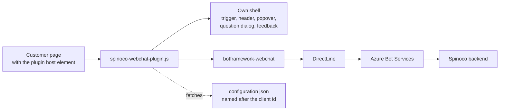
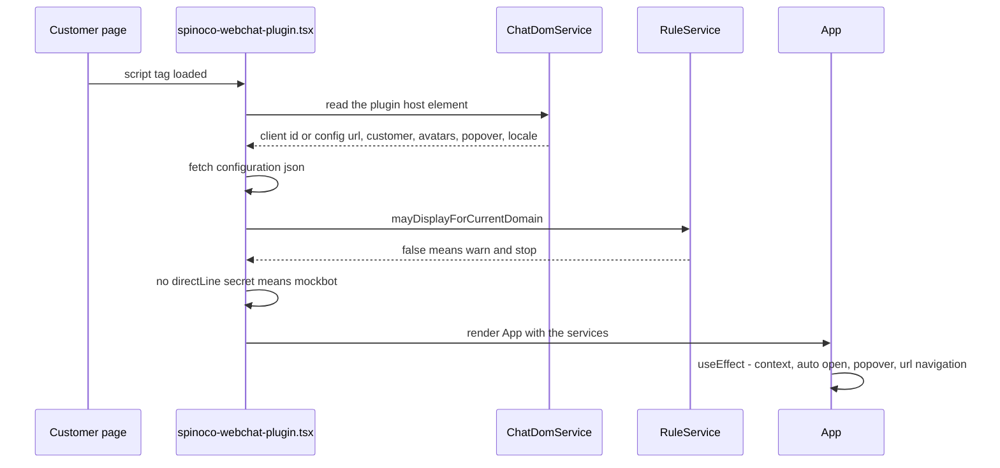
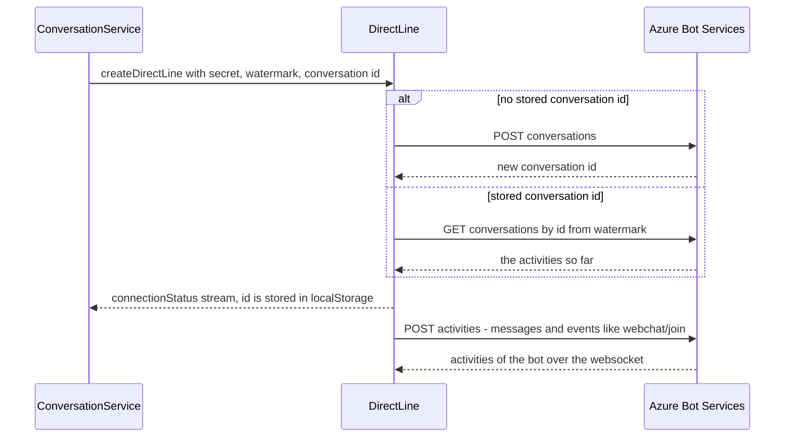
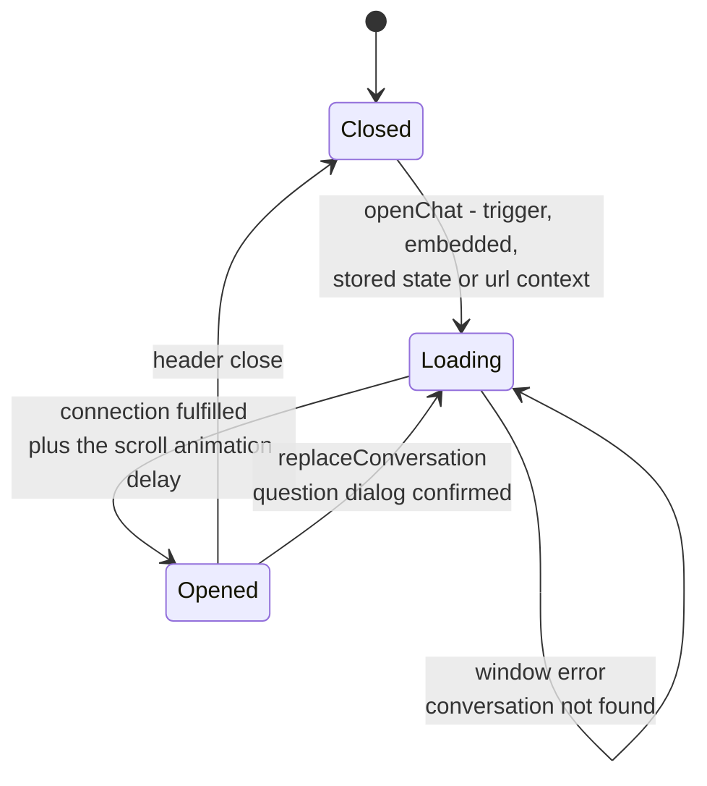
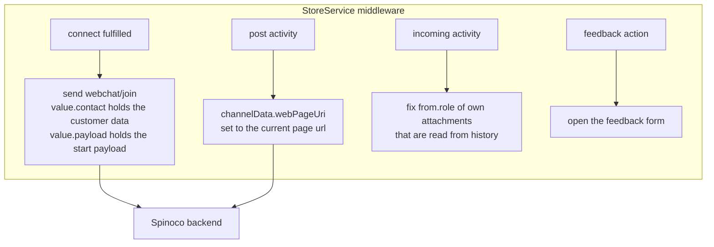
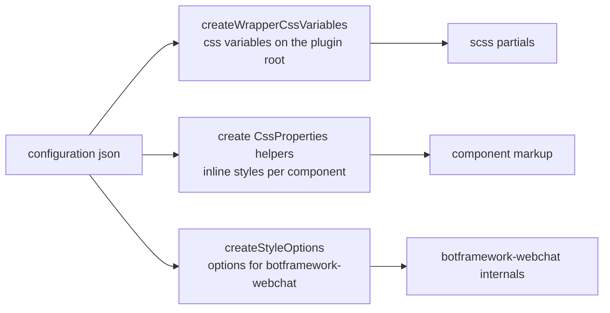

# Architecture

How this repository is put together and how the plugin works at runtime.

## What is built here

Two artifacts come out of one source tree:

| Artifact | Built by | Entry | Purpose |
|---|---|---|---|
| **The plugin** | `npm run build:plugin` (`vite.config.plugin.ts`) | `src/spinoco-webchat-plugin.tsx` | Single js file dropped on a customer page. Css is inlined into the js (`vite-plugin-css-injected-by-js`), so there is nothing else to load. |
| **The showcase** | `npm run build:web` (`vite.config.web.ts`) | `index.html` + `examples/*.html` | Github pages site that demonstrates the themes, served from <https://spinoco.github.io/webchat-plugin/>. |

The plugin is a wrapper around **`botframework-webchat`** (Microsoft Bot Framework Web Chat) that
- brands it from a json configuration,
- hosts it in a trigger / window / popover shell of our own,
- and speaks to the Spinoco backend through **DirectLine**.

## Repository layout

| Path | Content |
|---|---|
| `src/spinoco-webchat-plugin.tsx` | Bootstrap: reads the host element, loads the configuration, wires the services, mounts `App`. |
| `src/app.tsx` | The whole ui state machine: trigger, chat window, popover, question dialog, feedback form. |
| `src/components/` | Presentational components (`trigger`, `header`, `popover`, `question-dialog`, `feedback-form/*`, `icons`). |
| `src/middlewares/` | `botframework-webchat` middlewares (avatars, typing indicator) + `device-query` (fullscreen detection). |
| `src/models/services/` | All behaviour that is not rendering, see [Services](#services). |
| `src/models/interfaces/configuration/` | Typed shape of the customer configuration json. |
| `src/models/interfaces/`, `models/dtos/`, `models/enums/` | Data shapes, value objects and enums. |
| `src/models/styles/` | `create*CssProperties` / `create*CssVariables` - configuration to inline styles and css variables. |
| `src/styles/` | Scss: `app.scss` (breakpoints, `rem()`, imports) + one partial per component + `features/` toggles. |
| `src/config/config.ts` | Non-configurable constants: class names, data attribute names, style fallbacks, api urls. |
| `src/config/style-options-config.ts` | Defaults handed to `botframework-webchat` `styleOptions`. |
| `public/*.json` | Example configurations (`basic`, `slevomat`, `border-only`, `lottie`, `mockbot`). |
| `examples/*.html` | Showcase pages, one per example configuration. |
| `readme/` | `usage.md` (host page integration), `configuration.md` (every config key), `development.md`, this file. |

## Bootstrap

- The host element **must** carry `data-client-id` (configuration is fetched from `${VITE_WEBCHAT_API_URL}/<clientId>.json`) or `data-config-url`. Otherwise the bootstrap throws.
- `window.spinocoWebchatPlugin` is the `GlobalEventService` instance - the public api of the plugin for the host page.

## Services

All services are constructed once in the bootstrap and handed to `App` as props.

| Service | Responsibility |
|---|---|
| `ChatDomService` (`DomService`) | The only place that touches the host element: data attributes, `getWindow()`. Produces `CustomerDto`, `BotDto`, `PopoverDto`. |
| `ConversationService` | Owns the DirectLine. Starts a conversation (restoring the stored id), replaces it, ends the previous one, recovers from a dead conversation. |
| `StoreService` | Owns the `botframework-webchat` redux store and its middleware - everything we inject into or read from the activity stream. |
| `ChatStorage` (`Storage`) | Typed `localStorage` access, keys in `ChatStorageKeys`. |
| `LocaleService` | Locale for `botframework-webchat`: `data-locale`, else `navigator.languages`, else `en`. |
| `RuleService` | Domain allow / deny list from `configuration.rules` - decides whether the plugin renders at all. |
| `UrlNavigationService` | Hash commands (`#sp-webchat;open`), on load and on `hashchange`. |
| `WebchatContextService` | Structured context in `?webchat_context=` (base64url json), see [usage.md](usage.md). |
| `GlobalEventService` | Callback bridge between the host page (`window.spinocoWebchatPlugin`) and `App`. |

## What DirectLine is

DirectLine is the channel that a browser client uses to talk to a bot hosted in Azure Bot
Services. It is a small http protocol - a conversation is opened, activities (messages, events,
typing notifications) are posted into it and received back from it. Spinoco is not addressed
directly: the chat gateway of a Spinoco instance sits behind that bot, so from the plugin the
whole backend is just "the bot on the other end of the DirectLine".

- The protocol is implemented by `botframework-directlinejs` (a transitive dependency).
- We never call it ourselves - `createDirectLine()` from `botframework-webchat` builds the object in `ConversationService`, and that object is handed to `ReactWebChat` as its `directLine` prop. Everything after that happens inside `botframework-webchat`.
- Transport is a websocket when the browser has one, with http polling as a fallback.

What `ConversationService` passes to it:

| Option | Value here | Meaning |
|---|---|---|
| `secret` | `configuration.directLine.secret` | Pairs the plugin with the Chat gateway of one Spinoco instance. It is part of the configuration json, so it is visible to anyone on the page - it grants nothing but the ability to talk to that bot. |
| `conversationId` | stored id, or `undefined` | Given, the previous conversation is resumed. Missing, a brand new one is opened and DirectLine assigns the id. |
| `watermark` | `"0"` | Position in the activity stream to receive from. Zero means from the very beginning, which is what replays the transcript when a conversation is resumed. |
| `domain` | `europe` / `india` / unset | Regional endpoint. Unset means the global `directline.botframework.com`. The region also shows up in the conversation id (`...-eu`, `...-us`). |

- The **conversation id is the identity of the chat**. Keeping it in `localStorage` is the whole mechanism behind "the conversation survives navigation and reloads", and dropping it is how a conversation is replaced.
- `connectionStatus$` is the only part of the object the plugin subscribes to - to learn the assigned id and to notice that the line is up.
- `end()` terminates the line; the plugin calls it when it replaces a conversation, so the old line stops receiving anything.
- With `useMockbot` (no secret configured) a token for Microsoft's public mockbot is fetched instead and the stored id is ignored - every reload starts a fresh conversation against the demo bot.

## Conversation lifecycle

A conversation is the pair *(DirectLine, redux store)*. The store holds the transcript, so a new
conversation always needs a new store - and the chat component has to be re-mounted for it, which
is what the `generation` counter in `App` is for.

- **Start / restore** - `startConversation()` creates the DirectLine with the stored `conversationId`; the id is (re)stored from `connectionStatus$`, but only while that DirectLine is still the current one.
- **Replace** - `replaceConversation()` ends the current DirectLine, drops the stored id and starts a new one. `App` recreates the store first, so the transcript of the old conversation goes away with it.
- **Recover** - a `window` error with `Conversation not found` / `Token not valid for this conversation` triggers the same replacement.
- **Mockbot** - when there is no `directLine.secret`, a token is fetched from the public mockbot and the stored conversation id is ignored. Handy for development without a Spinoco instance.

## Activity flow

Everything we add to or fix in the activity stream lives in the `StoreService` middleware.

- `webchat/join` is how the backend learns who is on the other side (`value.contact`) and, when the conversation was started from a url context, which workflow to start (`value.payload`, mirrors the backend `ChatConversationStartPayload`).
- The start payload is bound to the store it was created with, so a conversation that is being replaced can never send it.

## State and storage

| Where | Value | Notes |
|---|---|---|
| `AppState` (`App`) | `loading` / `loaded` / `popover` / `feedback` | Which overlay is on screen. |
| `ChatState` (`App`) | `closed` / `loading` / `opened` | Visibility of the chat window, mirrored into storage. |
| `localStorage swp-conversation-id` | DirectLine conversation id | Lets the conversation survive navigation and reloads. |
| `localStorage swp-chat-state` | Last `ChatState` | The window re-opens on the next page unless the device is fullscreen (mobile). |
| `localStorage swp-app-state` | - | Declared in `ChatStorageKeys` but never written, dead key. |

## Styling

Three layers, in this order of preference:

- **Css variables** for anything shared - they are set once on the plugin root and consumed from scss. This is what a new component should reach for first, so it follows the theme for free, see [configuration.md](configuration.md) for the ones that carry the configuration.
- **Inline styles** (`create*CssProperties`) where a value belongs to one element only, or where scss cannot express it.
- **`styleOptions`** for everything inside `botframework-webchat` (bubbles, send box, avatars, root size).
- Class names are prefixed `swp-` and declared in `config.classes` when they are referenced from tsx.
- Scss conventions: one partial per component imported from `src/styles/app.scss`, `rem()` helper, `@include tablet / mobile / low-height-screen` breakpoints, stylelint with `sass-guidelines` + rational property order.
- Optional looks are `features/*.scss`, toggled by `configuration.features` through `createChatBoxWrapperClasses`.

## Host page integration points

| Mechanism | Used for |
|---|---|
| `data-*` attributes on the host element | Client id / config url, customer identity, avatars, popover texts, locale. |
| `window.spinocoWebchatPlugin` | `openChat()`, `showPopover(...)`, `showFeedback()`. |
| `#sp-webchat;<command>` hash | `open` - opening the chat from a plain link. |
| `?webchat_context=<base64url json>` | Starting a conversation with a hinted workflow and parameters. |

See [usage.md](usage.md) for the details of each.

## Build, ci and deployment

| Command | Result |
|---|---|
| `npm run dev` | Vite dev server on `:4444`, serves the showcase pages from source. |
| `npm run build` | `build:web` then `build:plugin`, both into `dist/` (`emptyOutDir: false` on the second, so it adds to the first). |
| `npm run lint` | `eslint src --max-warnings=0` + `stylelint src/styles/**/*.scss`. |

- `dist/assets/*` is the showcase, `dist/dist/spinoco-webchat-plugin.js` is the plugin itself.
- `.github/workflows/github-actions.yml`: install -> lint -> build -> deploy to github pages, `main` and `staging` branches have their own environments. `.gitlab-ci.yml` mirrors install / lint / build.
- Base path is `/webchat-plugin` in production builds and is injected into the html through `vite-plugin-ejs` (`<%= basePath %>`).

## Gotchas

- **`--legacy-peer-deps` is mandatory** - `vite-plugin-ejs` demands a newer vite than the one pinned here, so a plain `npm install` / `npm ci` fails.
- **Tailwind does not reach the plugin** - `tailwind.config.cjs` scans only `index.html` and `examples/*.html`, so utility classes written in `src/*.tsx` (`Popover`, `FeedbackForm`) are not in the built css. New components should use scss, not tailwind.
- **The chat window has no size of its own** - it is sized by the mounted `botframework-webchat` (`styleOptions.rootWidth/rootHeight`, default 400x500). Anything drawn before the chat mounts has to bring its own dimensions (see the loader), or wait for it to mount (see the question dialog).
- **The transcript can only be dropped by recreating the store** - the `botframework-webchat` activities reducer never clears on reconnect.
- **`React.StrictMode` doubles the mount effects in development** - the initial `openChat()` runs twice and two conversations are created. Production is unaffected.
- **The feedback form is a demo** - the instance id is hardcoded in `StoreService` (`TODO`) and the configuration is fetched from `VITE_FEEDBACK_API_URL`.
- **There are no automated tests** in the repository; `lint` and the type check (`tsc` as part of the build) are the only gates.
